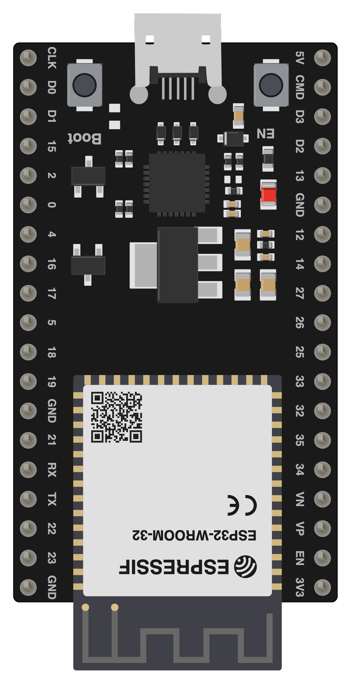
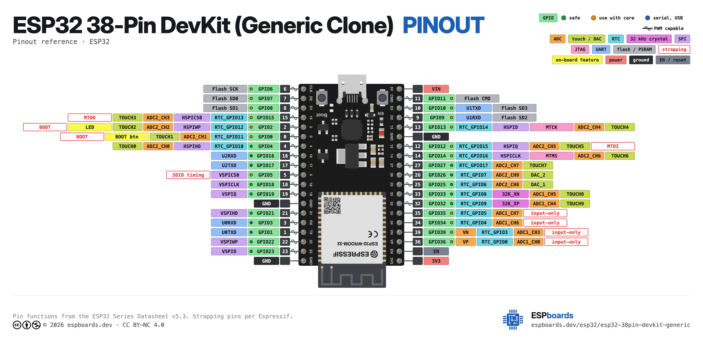

# ESP32 38-Pin DevKit (Generic Clone)

Generic ESP32 development board with 38 pins (19 per side), 4 MB flash, Micro-USB. Widely available on AliExpress, Amazon, and eBay — often labeled "ESP32_DevKitC_V4" or "ESP32-WROOM-32". Copies Espressif's ESP32-DevKitC with 1.0 in (25.4 mm) header row spacing.

## Links

- Board page: https://www.espboards.dev/esp32/esp32-38pin-devkit-generic/
- ESP32 datasheet: https://cdn.espboards.net/mcus/esp32/datasheet.pdf
- ESP32-DevKitC V4 Hardware Reference (Espressif): https://docs.espressif.com/projects/esp-dev-kits/en/latest/esp32/esp32-devkitc/index.html
- CH340 Driver (Windows): https://www.wch.cn/downloads/CH341SER_EXE.html
- CP2102 Driver: https://www.silabs.com/developers/usb-to-uart-bridge-vcp-drivers

## Photos





## Specifications

| Spec       | Detail                                            |
| ---------- | ------------------------------------------------- |
| MCU        | ESP32 — Xtensa dual-core LX6, 240 MHz             |
| Flash      | 4 MB (32 Mb), DIO                                 |
| PSRAM      | None (on most clones)                             |
| Wireless   | Wi-Fi 802.11 b/g/n, Bluetooth 4.2 + BLE          |
| USB        | Micro-USB (CH340C / CH9102F / CP2102 USB-UART)    |
| Dimensions | 48.26 × 27.94 mm (1.9 × 1.1 in)                  |
| Pin count  | 38 pins (19 per side), 32 GPIO broken out         |
| Antenna    | On-board PCB antenna                              |

### USB-to-Serial Chips (varies by board)

| Chip       | Package    | Notes                              |
| ---------- | ---------- | ---------------------------------- |
| CH340C/G   | Rectangle  | Most common on cheap clones        |
| CP2102     | Square     | Common on mid-range boards         |
| CH9102F    | Square     | Newer chip, similar to CP2102      |
| FT232RL    | Rectangle  | Less common, found on some boards  |

### Power Regulators (varies by board)

| Regulator  | Package    | Notes                              |
| ---------- | ---------- | ---------------------------------- |
| AMS1117    | SOT-223    | Older clones, gets hot under load  |
| ME6211 / HT7333 | SOT-89/SOT-23 | Newer LDO, better efficiency |

### Common Board Labels

- **NodeMCU-32S** — CP2102-based, narrower (0.9 in row spacing)
- **ESP32 DevKit V1** — Generic label, various USB chips
- **ESP32-WROOM-32** — Refers to the module, not the board itself

## Pin Mapping — 38 Pins (19 per side)

| Pin | GPIO  | Labels              | Status       | Capabilities       | Notes                                          |
| --- | ----- | ------------------- | ------------ | ------------------ | ---------------------------------------------- |
| 1   | —     | 3V3, 3.3V           | power        | —                  | 3.3V regulated output (~600mA max)             |
| 2   | —     | EN                  | control      | —                  | Chip enable / reset (active LOW)               |
| 3   | 36    | VP, GPIO36, A0      | strapping    | adc                | SENSOR_VP, ADC1_CH0, input only, no pull resistors |
| 4   | 39    | VN, GPIO39, A3      | strapping    | adc                | SENSOR_VN, ADC1_CH3, input only, no pull resistors |
| 5   | 34    | D34, GPIO34, A6     | strapping    | adc                | ADC1_CH6, input only, no pull resistors        |
| 6   | 35    | D35, GPIO35, A7     | strapping    | adc                | ADC1_CH7, input only, no pull resistors        |
| 7   | 32    | D32, GPIO32, A4     | safe         | adc, touch         | ADC1_CH4, Touch9                               |
| 8   | 33    | D33, GPIO33, A5     | safe         | adc, touch         | ADC1_CH5, Touch8                               |
| 9   | 25    | D25, GPIO25, A18    | safe         | adc, dac           | DAC1, ADC2_CH8                                 |
| 10  | 26    | D26, GPIO26, A19    | safe         | adc, dac           | DAC2, ADC2_CH9                                 |
| 11  | 27    | D27, GPIO27, A17    | safe         | adc, touch         | ADC2_CH7, Touch7                               |
| 12  | 14    | D14, GPIO14, A16    | strapping    | adc, touch, spi    | ADC2_CH6, Touch6, HSPI_CLK                     |
| 13  | 12    | D12, GPIO12, A15    | strapping    | adc, touch, spi    | ADC2_CH5, Touch5, HSPI_MISO, flash voltage     |
| 14  | —     | GND                 | ground       | —                  | Ground                                         |
| 15  | 13    | D13, GPIO13, A14    | strapping    | adc, touch, spi    | ADC2_CH4, Touch4, HSPI_MOSI                    |
| 16  | 9     | SD2, GPIO9          | strapping    | —                  | Internal SPI flash (SD_DATA2) — not usable     |
| 17  | 10    | SD3, GPIO10         | strapping    | —                  | Internal SPI flash (SD_DATA3) — not usable     |
| 18  | 11    | CMD, GPIO11         | strapping    | —                  | Internal SPI flash (SD_CMD) — not usable       |
| 19  | —     | VIN, 5V             | power        | —                  | 5V input to onboard regulator                  |
| 20  | —     | GND                 | ground       | —                  | Ground                                         |
| 21  | 23    | D23, GPIO23         | safe         | spi                | VSPI_MOSI                                      |
| 22  | 22    | D22, GPIO22         | safe         | i2c                | I2C_SCL (default)                              |
| 23  | 1     | TX0, GPIO1          | uart         | uart               | UART0 TX (USB serial)                          |
| 24  | 3     | RX0, GPIO3          | uart         | uart               | UART0 RX (USB serial)                          |
| 25  | 21    | D21, GPIO21         | safe         | i2c                | I2C_SDA (default)                              |
| 26  | —     | GND                 | ground       | —                  | Ground                                         |
| 27  | 19    | D19, GPIO19         | safe         | spi                | VSPI_MISO                                      |
| 28  | 18    | D18, GPIO18         | safe         | spi                | VSPI_CLK                                       |
| 29  | 5     | D5, GPIO5           | strapping    | spi                | VSPI_CS, Strapping pin                         |
| 30  | 17    | TX2, GPIO17         | uart         | uart               | UART2 TX                                       |
| 31  | 16    | RX2, GPIO16         | uart         | uart               | UART2 RX                                       |
| 32  | 4     | D4, GPIO4, A10      | safe         | adc, touch         | ADC2_CH0, Touch0                               |
| 33  | 0     | D0, GPIO0, A11      | strapping    | adc, touch         | ADC2_CH1, Touch1, Boot button (strapping pin)  |
| 34  | 2     | D2, GPIO2, A12      | strapping    | adc, touch         | ADC2_CH2, Touch2, on-board LED, Strapping pin  |
| 35  | 15    | D15, GPIO15, A13    | strapping    | adc, touch, spi    | ADC2_CH3, Touch3, HSPI_CS, Strapping pin       |
| 36  | 8     | SD1, GPIO8          | strapping    | —                  | Internal SPI flash (SD_DATA1) — not usable     |
| 37  | 7     | SD0, GPIO7          | strapping    | —                  | Internal SPI flash (SD_DATA0) — not usable     |
| 38  | 6     | CLK, GPIO6          | strapping    | —                  | Internal SPI flash (SD_CLK) — not usable       |

## Free GPIOs (safe to use)

| GPIO | Notes                                      |
| ---- | ------------------------------------------ |
| 4    | ADC2_CH0, Touch0                           |
| 16   | UART2 RX                                   |
| 17   | UART2 TX                                   |
| 18   | VSPI_CLK                                   |
| 19   | VSPI_MISO                                  |
| 21   | I2C_SDA (default)                          |
| 22   | I2C_SCL (default)                          |
| 23   | VSPI_MOSI                                  |
| 25   | DAC1, ADC2_CH8                             |
| 26   | DAC2, ADC2_CH9                             |
| 27   | ADC2_CH7, Touch7                           |
| 32   | ADC1_CH4, Touch9                           |
| 33   | ADC1_CH5, Touch8                           |

## GPIOs to use with care (strapping / system duties)

| GPIO | Notes                                      |
| ---- | ------------------------------------------ |
| 0    | Boot button, strapping pin (must be HIGH at boot) |
| 1    | UART0 TX (USB serial programming)          |
| 2    | On-board LED, strapping pin (must be LOW/floating) |
| 3    | UART0 RX (USB serial programming)          |
| 5    | VSPI_CS, strapping pin (must be HIGH at boot) |
| 12   | HSPI_MISO, strapping pin (flash voltage select) |
| 13   | HSPI_MOSI, JTAG TCK                        |
| 14   | HSPI_CLK, JTAG TMS                         |
| 15   | HSPI_CS, strapping pin (debug output)      |
| 34   | Input only, no pull resistors              |
| 35   | Input only, no pull resistors              |
| 36   | Input only, no pull resistors              |
| 39   | Input only, no pull resistors              |

## GPIOs to avoid (flash pins)

| GPIO | Notes                                      |
| ---- | ------------------------------------------ |
| 6    | SPI flash clock — will cause boot failure  |
| 7    | SPI flash data 0 — not usable              |
| 8    | SPI flash data 1 — not usable              |
| 9    | SPI flash data 2 (HOLD) — not usable       |
| 10   | SPI flash data 3 (WP) — not usable         |
| 11   | SPI flash CMD/CS0 — not usable             |

## PlatformIO

```ini
[env:esp32-38pin-devkit-generic]
platform = espressif32
board = esp32dev
framework = arduino
monitor_speed = 115200
upload_speed = 921600
```

## Notes

- **38 pins total** → 19 per side, wider than standard 30-pin boards (may not fit standard 400-point breadboards)
- **USB-to-serial chip varies** — CH340C/G (most common), CP2102, or CH9102F. Driver installation may be required.
- **Strapping pins** (GPIO0, GPIO2, GPIO12, GPIO15) must be in correct state during boot
- **GPIO 6–11 are connected to internal SPI flash** — never use these pins in your projects
- **GPIO 34, 35, 36, 39 are input-only** — no pull-ups, no output capability
- **VIN pin** allows external 5V power without USB
- **On-board LED** is typically on GPIO2 (check your specific board)
- **EN/Boot buttons** are onboard — hold BOOT while plugging in if no port appears
- Some boards label ADC pins as VP, VN, SVP, SVN instead of GPIO numbers
- The pinout matches most 38-pin ESP32 development boards, including NodeMCU-32S and wider ESP32 DevKit clones
- Board often prints "ESP32_DevKitC_V4" or "ESP32-WROOM-32" on the silkscreen
