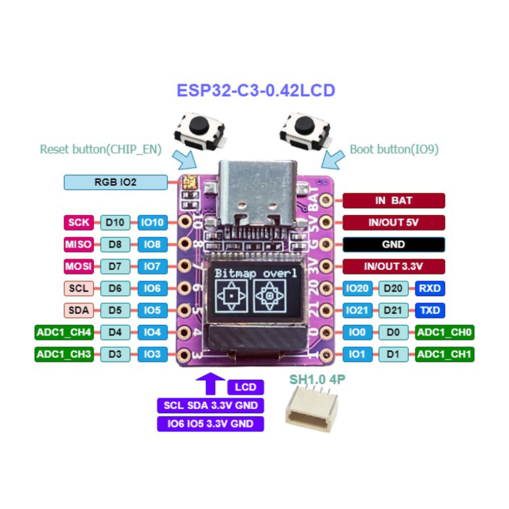
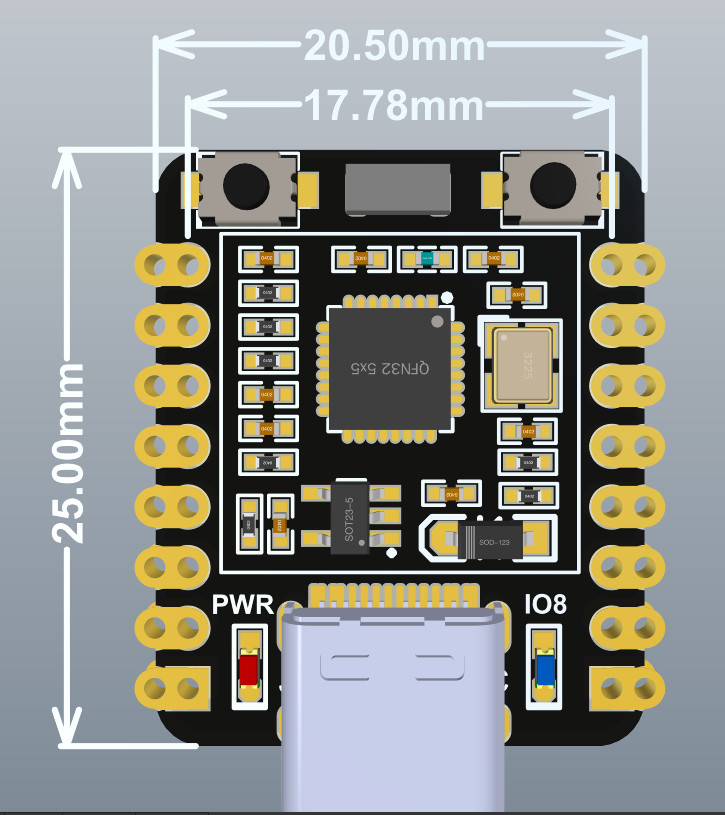

# ESP32-C3 Super Mini Plus (V2.0)

Enhanced ESP32-C3 Super Mini variant with an onboard **0.42" OLED display** (72x40 pixels). Manufactured by TENSTAR. Red PCB. Otherwise identical ESP32-C3-FH4 platform with USB Type-C and compact SMD antenna.

## Links

- TENSTAR on AliExpress: search "TENSTAR ESP32-C3 Supermini Plus"
- 01Space GitHub (OLED variant reference): https://github.com/01Space/ESP32-C3-0.42LCD
- Mario's Ideas tutorial (OLED programming): https://www.youtube.com/watch?v=B-t_nMiXfZM
- Hacktuber OLED demo: https://www.youtube.com/watch?v=jdYcntc-zz0

## Photos



## Pinout


## Dimensions



## Schematic


- 01Space schematic PDF: [schematic-01space.pdf](schematic-01space.pdf)
- ABRobot schematic PDF: [schematic-abrobot.pdf](schematic-abrobot.pdf)

## Specifications

| Spec          | Detail                                                  |
| ------------- | ------------------------------------------------------- |
| MCU           | ESP32-C3-FH4 — RISC-V 32-bit single-core, up to 160 MHz |
| Flash         | 4 MB (onboard SPI flash)                                |
| PSRAM         | None                                                    |
| SRAM          | 400 KB                                                  |
| ROM           | 384 KB                                                  |
| Wireless      | Wi-Fi 802.11 b/g/n (2.4 GHz), Bluetooth 5 (LE)          |
| USB           | Type-C (native USB-Serial-JTAG, no UART bridge)         |
| Antenna       | Onboard ceramic antenna                                 |
| OLED Display  | 0.42" I2C OLED, 72x40 pixels (SSD1306-compatible)       |
| OLED I2C Pins | SDA = GPIO5, SCL = GPIO6                                |
| LED           | Blue LED on GPIO8 (active low)                          |
| Power LED     | Yes (separate from GPIO8 LED)                           |
| Buttons       | BOOT (GPIO9), RESET                                     |
| Input Voltage | 5V (USB) or 3.3–6V (5V pin)                             |
| Logic Level   | 3.3V                                                    |
| GPIO          | 13 GPIO pins exposed                                    |
| Board Size    | ~22.5 x 18 mm (same footprint as Super Mini)            |
| PCB Color     | Red                                                     |

## Key Notes

- **Onboard OLED display** is connected via I2C on **GPIO5 (SDA) and GPIO6 (SCL)** — these are NOT the default I2C pins. You must declare them manually: `Wire.begin(5, 6)`.
- Since GPIO5 and GPIO6 are used for the OLED, they are unavailable for SPI (they are the default SPI MISO and MOSI pins). If you need SPI, reassign pins to e.g. SCK=GPIO4, MOSI=GPIO3, MISO=GPIO1, CS=GPIO2.
- The OLED has a **non-standard display offset** (starting point is 12,8 or 64,32 depending on model). Standard Adafruit SSD1306 libraries may not work out of the box — use the library from the 01Space GitHub or adjust display offset manually.
- **Bitmap data** may need bit-order reversal per byte compared to standard OLEDs.
- LED on **GPIO8** is active low (LOW = ON).
- **No USB-UART chip** — uses ESP32-C3 native USB. To enter download mode: hold BOOT, press RESET, release BOOT.
- GPIO12–GPIO17 are **not exposed** (used internally for Flash).
- Default UART0: TX = GPIO21, RX = GPIO20.
- For Arduino IDE: enable **"USB CDC On Boot"** for Serial output.

## GPIO Pinout

| Pin   | Function(s)                                                |
| ----- | ---------------------------------------------------------- |
| 3V3   | 3.3V output (from regulator, output only — do NOT power board through this) |
| 5V    | 5V input (from USB or external 3.7–6V)                    |
| GND   | Ground                                                     |
| GPIO0 | ADC1_CH0, PWM                                              |
| GPIO1 | ADC1_CH1, PWM                                              |
| GPIO2 | ADC1_CH2, **Strapping Pin**                                |
| GPIO3 | ADC1_CH3, PWM                                              |
| GPIO4 | ADC1_CH4, PWM                                              |
| GPIO5 | **OLED SDA** (used by onboard display), ADC1_CH5           |
| GPIO6 | **OLED SCL** (used by onboard display)                     |
| GPIO7 | PWM                                                        |
| GPIO8 | Onboard LED (active low), **Strapping Pin**                |
| GPIO9 | BOOT button, **Strapping Pin**                             |
| GPIO10| PWM                                                        |
| GPIO20| Default UART RX                                            |
| GPIO21| Default UART TX                                            |

## Peripherals

| Peripheral | Default Pins              | Count |
| ---------- | ------------------------- | ----- |
| SPI        | reassign needed (5/6 used by OLED) | 3x (1 user-accessible) |
| I2C        | OLED uses SDA=5, SCL=6 (non-default) | 1x    |
| UART       | RX=20, TX=21              | 2x    |
| I2S        | pin-assignable            | 1x    |
| ADC        | GPIOs 0–5 (12-bit, ADC1)  | 6 channels |
| PWM        | all general-purpose GPIOs | 6 channels |

## OLED Display Notes

The onboard 0.42" OLED requires special handling:

```cpp
#include <Wire.h>
#include <U8g2lib.h>

U8G2_SSD1306_72X40_ER_F_HW_I2C display(U8G2_R0, U8X8_PIN_NONE);

void setup() {
    Wire.begin(5, 6);  // SDA=GPIO5, SCL=GPIO6
    display.begin();
    display.setFont(u8x8_font_chroma48medium8_r);
    display.drawString(0, 0, "Hello!");
    display.sendBuffer();
}
```

Alternative: use `U8G2_SSD1306_64X32_F_HW_I2C` for 64x32 variants (check your specific board).

## PlatformIO

```ini
[env:esp32-c3-supermini-plus]
platform = espressif32
board = esp32-c3-devkitm-1
framework = arduino
monitor_speed = 115200
build_flags =
    -DARDUINO_USB_CDC_ON_BOOT=1
lib_deps =
    olikraus/U8g2@^2.35.9
```

## Differences from ESP32-C3 Super Mini (Standard)

| Feature            | Super Mini (Standard)       | Super Mini Plus                   |
| ------------------ | --------------------------- | --------------------------------- |
| OLED Display       | None                        | 0.42" I2C OLED (72x40)           |
| PCB Color          | Black                       | Red                               |
| GPIO5/6            | Free (SPI default pins)     | Used by onboard OLED (I2C)       |
| LED                | Blue LED on GPIO8           | Blue LED on GPIO8 + Power LED    |
| SPI availability   | Default pins available      | Must reassign pins (5/6 occupied) |
