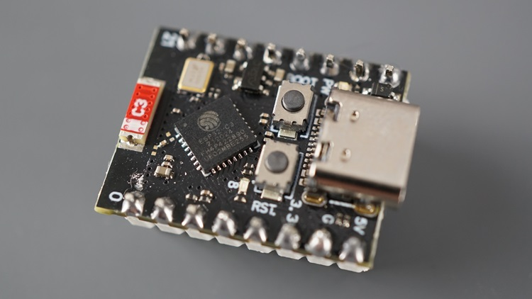
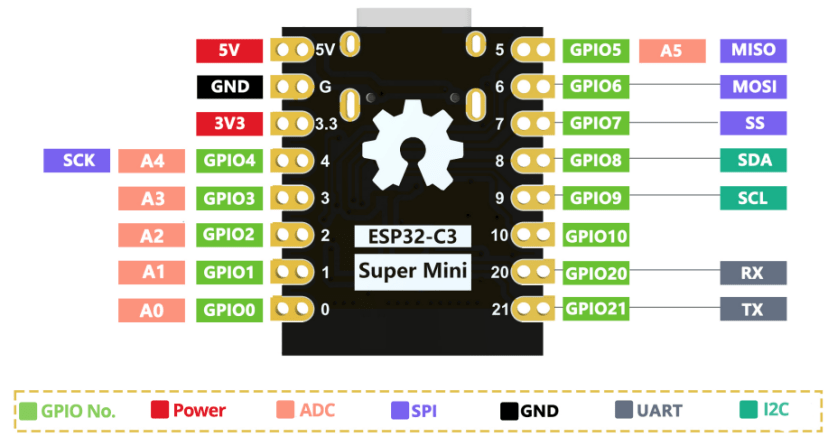

# ESP32-C3 Super Mini

Ultra-small ESP32-C3-FH4 development board with USB Type-C, compact SMD antenna, and 16-pin header. The most popular low-cost ESP32-C3 board, available from many manufacturers (TENSTAR, Teyleten Robot, HWGATL, AITRIP, etc.).

> **Note:** The TENSTAR ESP32-C3-Zero is the castellated (no-header) variant of this board, documented separately.

## Links

- Random Nerd Tutorials (reference): https://randomnerdtutorials.com/getting-started-esp32-c3-super-mini/
- Andreas Spiess comparison video: https://www.youtube.com/watch?v=hBBORq_yHrw
- Mario's Ideas tips video: https://www.youtube.com/watch?v=IzLD6f8cDHs

## Photos



## Pinout



## Specifications

| Spec          | Detail                                                  |
| ------------- | ------------------------------------------------------- |
| MCU           | ESP32-C3-FH4 — RISC-V 32-bit single-core, up to 160 MHz |
| Flash         | 4 MB (onboard SPI flash)                                |
| PSRAM         | None                                                    |
| SRAM          | 400 KB                                                  |
| ROM           | 384 KB                                                  |
| Wireless      | Wi-Fi 802.11 b/g/n (2.4 GHz), Bluetooth 5 (LE)          |
| USB           | Type-C (native USB-Serial-JTAG, no UART bridge)         |
| Antenna       | Compact SMD antenna (some variants: U.FL connector)     |
| LED           | Blue LED on GPIO8 (active low)                          |
| Buttons       | BOOT (GPIO9), RESET                                     |
| Input Voltage | 5V (USB) or 3.3–6V (5V pin)                             |
| Logic Level   | 3.3V                                                    |
| LDO Regulator | ME6211 (3.3V, up to 500 mA)                             |
| GPIO          | 11 accessible GPIOs (16 pins total on header)           |
| Board Size    | ~22.5 x 18 mm                                           |

## Key Notes

- **No USB-UART chip** — uses ESP32-C3 native USB. To enter download mode: hold BOOT, press RESET, release BOOT.
- GPIO12–GPIO17 are **not exposed** (used internally for Flash).
- Onboard LED on **GPIO8** (active low — LOW = ON, HIGH = OFF). This is different from the C3-Zero which uses WS2812 on GPIO10.
- Default UART0: TX = GPIO21, RX = GPIO20.
- For Arduino IDE: enable **"USB CDC On Boot"** for Serial output.
- **Antenna warning:** Some cheap clones have a capacitor placement issue that degrades Wi-Fi. TENSTAR boards are reported as good quality.
- **Breadboard Wi-Fi:** Metal in breadboards can block the antenna. Use stacking headers (15mm) to raise the board.
- **Strapping pins:** GPIO2, GPIO8, and GPIO9 are strapping pins — use with caution.
- **I2C on GPIOs 8/9** may cause boot issues with some devices (OLEDs, sensors). Move to different pins if problems occur.

## GPIO Pinout

| Pin   | Function(s)                                                |
| ----- | ---------------------------------------------------------- |
| 3V3   | 3.3V output (from regulator) / input                      |
| 5V    | 5V input (from USB or external)                           |
| GND   | Ground                                                     |
| GPIO0 | ADC1_CH0, PWM                                              |
| GPIO1 | ADC1_CH1, PWM                                              |
| GPIO2 | ADC1_CH2, **Strapping Pin** (Boot Mode) — avoid general use |
| GPIO3 | ADC1_CH3, PWM                                              |
| GPIO4 | ADC1_CH4, PWM, default SPI SCK                             |
| GPIO5 | ADC1_CH5, PWM, default SPI MISO                            |
| GPIO6 | PWM, default SPI MOSI                                      |
| GPIO7 | PWM, default SPI SS                                        |
| GPIO8 | Onboard LED (active low), **Strapping Pin**, default I2C SDA |
| GPIO9 | BOOT button, **Strapping Pin**, default I2C SCL           |
| GPIO10| PWM                                                        |
| GPIO20| Default UART RX                                            |
| GPIO21| Default UART TX                                            |

## Peripherals

| Peripheral | Default Pins              | Count |
| ---------- | ------------------------- | ----- |
| SPI        | SCK=4, MISO=5, MOSI=6, SS=7 | 3x (1 user-accessible) |
| I2C        | SDA=8, SCL=9              | 1x    |
| UART       | RX=20, TX=21              | 2x    |
| I2S        | pin-assignable            | 1x    |
| ADC        | GPIOs 0–5 (12-bit, ADC1)  | 6 channels |
| PWM        | all general-purpose GPIOs | 6 channels |

## Power Consumption (Deep Sleep)

| Condition                          | Current Draw |
| ---------------------------------- | ------------ |
| Datasheet (deep sleep)             | ~43 uA       |
| Measured (as-is, via 5V pin)       | ~600 uA      |
| LED removed, via 5V pin            | ~100 uA      |
| LED removed + LDO replaced (LN6206P332) | ~7–11 uA |

## PlatformIO

```ini
[env:esp32-c3-supermini]
platform = espressif32
board = esp32-c3-devkitm-1
framework = arduino
monitor_speed = 115200
build_flags =
    -DARDUINO_USB_CDC_ON_BOOT=1
```

In Arduino IDE, select board **"ESP32C3 Dev Module"** and enable **"USB CDC On Boot"**.
